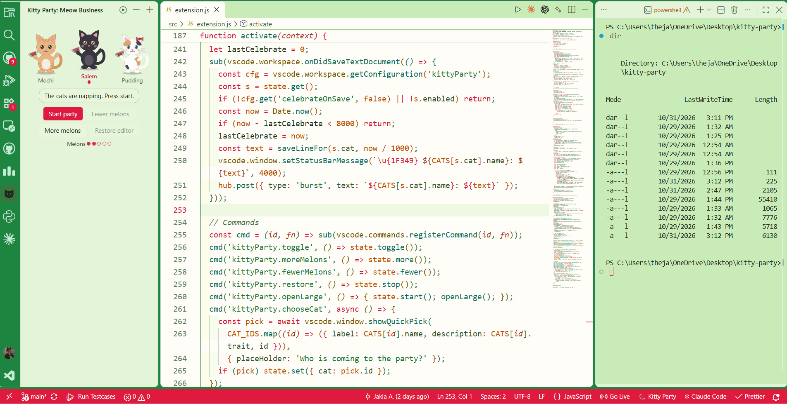
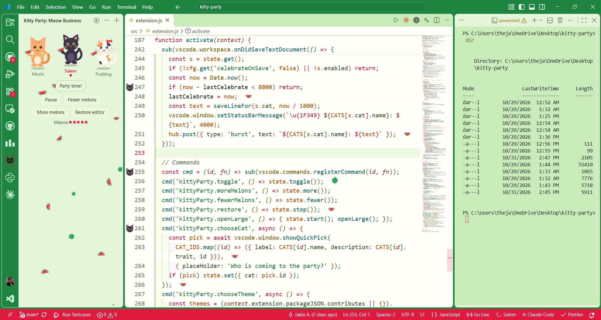
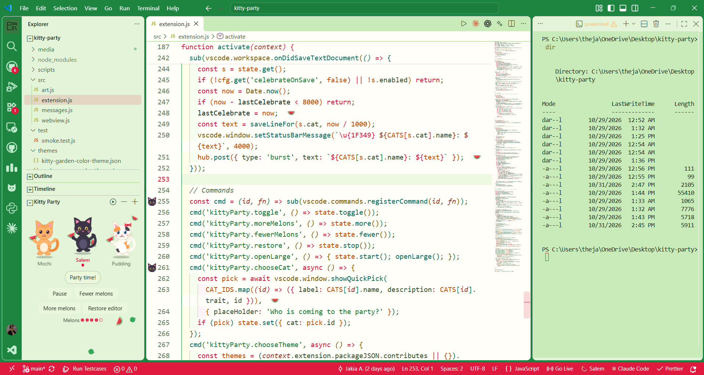
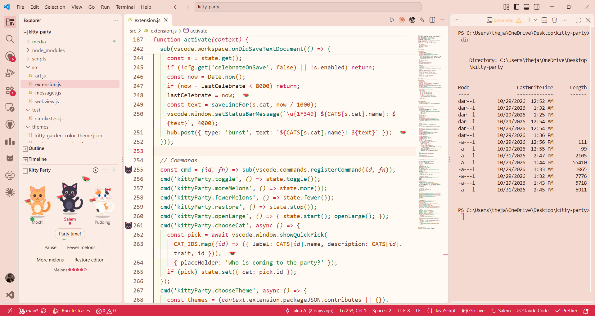
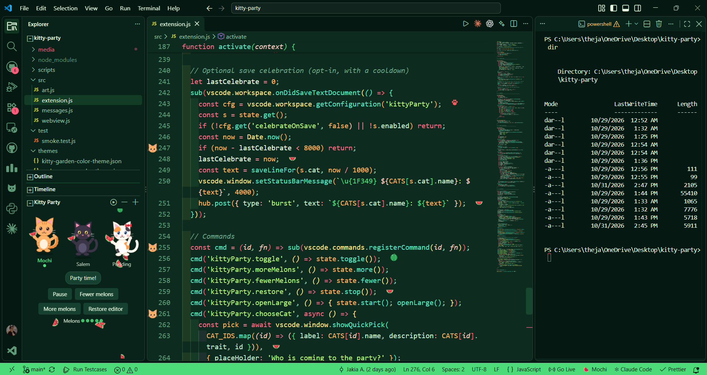
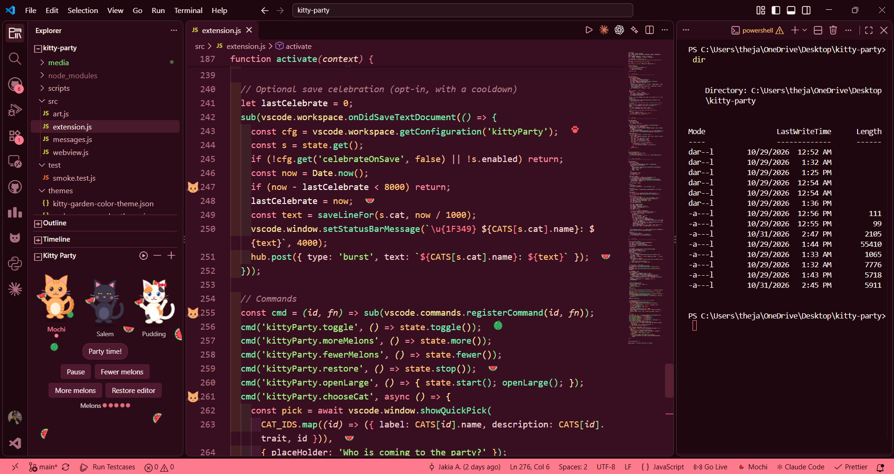
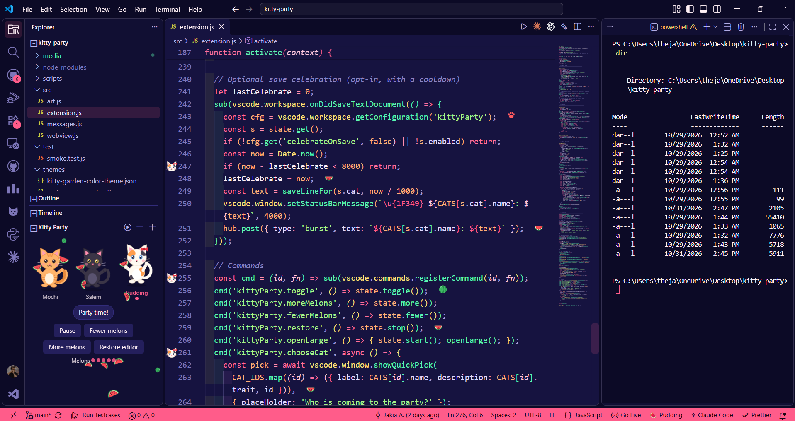

# Kitty Party

Five watermelon color themes for VS Code, plus an opt-in party: dancing cats, falling watermelon slices, and small decorations in your editor.

The themes are always on once you pick one. The party is off until you start it.





## Themes

| Theme                         | Type  |
| ----------------------------- | ----- |
| Kitty Party: Melon Cream Rind | Light |
| Kitty Party: Melon Cream      | Light |
| Kitty Party: Garden Theme     | Dark  |
| Kitty Party: Midnight Melon   | Dark  |
| Kitty Party: Watermelon Patch | Dark  |

Pick one with `Preferences: Color Theme`, or run **Kitty Party: Choose Watermelon Theme** from the Command Palette.

### Melon Cream Rind


### Melon Cream


### Garden Theme


### Midnight Melon


### Watermelon Patch


## The party

Click the cat icon in the Activity Bar (view name: **Meow Business**) and press **Start party**.

- **Three cats:** Mochi (orange tabby), Salem (black cat) and Pudding (calico). Click one to choose who comes.
- **Melon levels 1 to 5:** more melons means more falling slices in the panel and more decorations in your editor.
- **Editor decorations:** small watermelon icons appear at the end of some visible lines, and your cat shows in the gutter on others. Hover a decoration for a short message from your cat.
- **Status bar item:** click to start or stop.
- **Large view:** **Kitty Party: Open Large Kitty Party** opens the cats in an editor tab.
- **Save celebration:** optional burst of melons when you save a file.

Decorations are visual only. The extension never edits your files.

Animations respect your system's reduced-motion setting.

## Commands

| Command                                  | What it does                                          |
| ---------------------------------------- | ----------------------------------------------------- |
| Kitty Party: Start or Stop Kitty Party   | Toggle the party                                      |
| Kitty Party: More Melons                 | Raise the melon level (starts the party if it is off) |
| Kitty Party: Fewer Melons                | Lower the level. At level 1 this stops the party      |
| Kitty Party: Restore Editor (Stop Party) | Stop and clear all decorations                        |
| Kitty Party: Open Large Kitty Party      | Open the large panel                                  |
| Kitty Party: Choose Your Cat             | Pick Mochi, Salem or Pudding                          |
| Kitty Party: Choose Watermelon Theme     | Pick one of the five themes                           |

## Settings

| Setting                      | Default | Description                                |
| ---------------------------- | ------- | ------------------------------------------ |
| `kittyParty.autoStart`       | `false` | Start the party on first launch            |
| `kittyParty.defaultLevel`    | `2`     | Melon level when the party starts (1 to 5) |
| `kittyParty.gutterCats`      | `true`  | Show your cat in the gutter                |
| `kittyParty.hoverMessages`   | `true`  | Show cat messages on hover                 |
| `kittyParty.celebrateOnSave` | `false` | Melon burst and status bar message on save |
| `kittyParty.statusBar`       | `true`  | Show the status bar item                   |

To turn the party off completely, run **Restore Editor (Stop Party)**. To use only the themes, never start it.

## Install

**From a release (works now):**

1. Download `kitty-party-x.y.z.vsix` from the [Releases](https://github.com/thejakia1/kitty-party/releases) page.
2. Run:
   ```
   code --install-extension kitty-party-x.y.z.vsix
   ```

**From the Marketplace:** coming soon.

## Development

```
git clone https://github.com/thejakia1/kitty-party.git
cd kitty-party
npm install
```

Open the folder in VS Code and press **F5** to launch an Extension Development Host.

| Script                 | What it does                                                              |
| ---------------------- | ------------------------------------------------------------------------- |
| `npm run build:themes` | Regenerate `themes/*.json` from the palettes in `scripts/build-themes.js` |
| `npm run build:assets` | Rebuild media assets                                                      |
| `npm test`             | Run the smoke tests                                                       |
| `npm run package`      | Build the `.vsix`                                                         |

### How it works

- **Themes** are generated from one palette object per theme, so all five share the same set of workbench and syntax token rules. Edit a palette, run `build:themes`, and the JSON is rewritten.
- **Art** (cats, slices, melons, paws) is drawn as inline SVG in `src/art.js`. There are no image files for the characters.
- **Editor decorations** are placed by hashing the file URI and line number (FNV-1a), so the same lines get the same decorations every time instead of jumping around on each refresh. Only visible lines are processed, and refreshes are debounced.
- **Webviews** use a strict Content Security Policy with nonces and no inline style attributes.

### Project layout

```
src/
  extension.js   activation, state, commands, decorations
  art.js         SVG cats, slices, melons
  webview.js     panel HTML, CSS and client script
  messages.js    cat dialogue lines
scripts/         theme and asset generators
themes/          generated theme JSON
media/           icon, activity bar icon, preview
test/            smoke tests
```

## Roadmap

- [x] Screenshots for every theme
- [x] Demo GIF
- [ ] Marketplace and Open VSX release
- [ ] More cats

## Contributing

Issues and pull requests are welcome. For theme changes, edit the palette in `scripts/build-themes.js` and run `npm run build:themes` rather than editing the JSON by hand.

## License

[MIT](LICENSE) © Jakia A.
